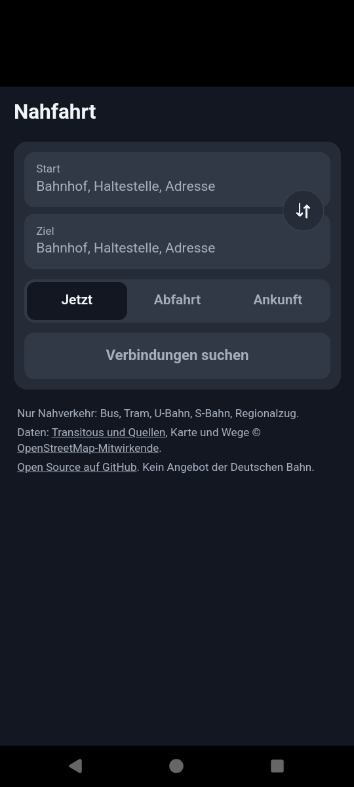
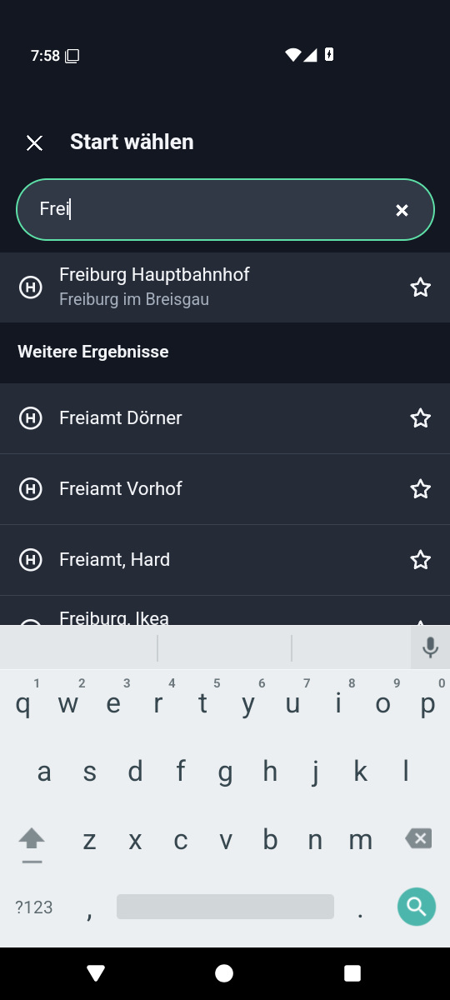
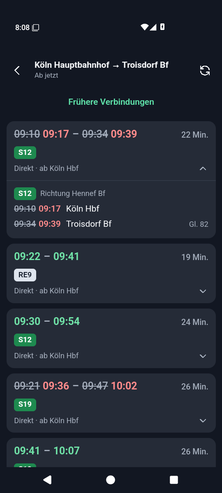
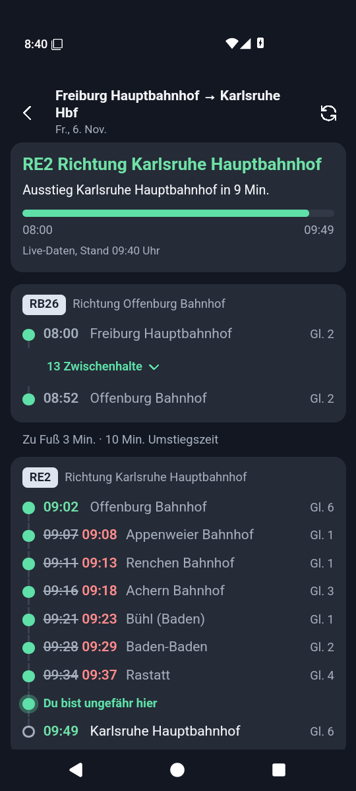

# Nahfahrt

Schlanke Verbindungsauskunft für Android, nur für Verbindungen mit dem Deutschlandticket. Gedacht für schlechtes Netz und knappes Datenvolumen. Kein Angebot der Deutschen Bahn.

<p>
  
  
  
  
</p>

## Installieren

Die aktuelle APK liegt unter [Releases](https://github.com/ElianDarou/nahfahrt/releases/latest). Android 8 oder neuer ist nötig. Android fragt beim ersten Mal, ob Installationen aus dieser Quelle erlaubt sind.

## Was die App kann

- **Nur Nahverkehr:** Bus, Tram, U-Bahn, S-Bahn, Regionalzug und Fähre, ohne Fernverkehr und Fernbusse.
- **Stationen sofort finden:** Genutzte Stationen liegen auf dem Gerät und stehen beim Tippen ganz oben, sortiert nach Häufigkeit und letzter Nutzung. Weitere Treffer laden darunter nach.
- **Favoriten und Strecken:** Favoriten lassen sich benennen, häufige Strecken starten mit einem Tipp.
- **Live-Daten:** Verspätungen, Ausfälle und Gleise, soweit die Verkehrsbetriebe sie liefern. Knappe Umstiege werden markiert.
- **Offline nutzbar:** Die zuletzt geladenen Verbindungen einer Strecke bleiben ohne Netz sichtbar.
- **Datum und Uhrzeit:** Suche nach Abfahrt oder Ankunft, dazu frühere und spätere Verbindungen.
- **Erweiterte Suche (aufklappbar):** Reihenfolge nach Abfahrt, Dauer oder Umstiegen, Zeitfenster für Abfahrt und Ankunft, maximale Umstiege und Reisedauer, Verkehrsmittel, Fußweg, längere Umstiegszeit, Zwischenhalt mit Aufenthalt und stufenfreie Fußwege.
- **Verbindungen merken und live verfolgen:** Gemerkte Verbindungen stehen auf der Startseite. Die Live-Ansicht zeigt Fortschritt, passierte Halte, den nächsten Halt, Umstiege, Verspätungen und Gleiswechsel. Nach der Ankunft verschwindet die Verbindung von selbst.

## Datenmenge

Die Oberfläche steckt komplett in der App, übers Netz läuft nur die Suche. Das Backend kürzt die Antworten auf das Nötigste.

| | Rohdaten (gzip) | Nahfahrt (gzip) |
|---|---|---|
| Größte Testsuche (5 Verbindungen, viele Umstiege) | 101 KB | etwa 0,7 KB |
| Typische Suche auf Testrouten | etwa 39 KB | 0,3–1 KB |
| Live-Ansicht: alle Halte einer Fahrt laden | | etwa 0,2 KB je Fahrt |
| Live-Ansicht: Aktualisierung pro Minute | | etwa 0,05 KB je Fahrt |
| APK | | etwa 0,8 MB |

## Aufbau

```
App (Preact, Capacitor)  →  Convex HTTP Actions  →  Transitous (MOTIS)
lokaler Cache im Gerät      kürzt, filtert, zählt     Fahrplan und Echtzeit
```

- `src/`: Oberfläche, lokaler Cache (`store.ts`), Stationsranking (`rank.ts`)
- `convex/lib/`: Abfragen an Transitous, Filter und Kürzung als reine, getestete Funktionen
- `src/progress.ts`, `src/saved.ts`: Fortschritt einer Fahrt und gemerkte Verbindungen
- `convex/http.ts`: Endpunkte `/v1/places`, `/v1/journeys` und `/v1/trip`
- `convex/quota.ts`: Tageslimits für Abfragen an Transitous
- `android/`: Capacitor-Projekt

### Warum nicht direkt die Bahn-API?

Die DB bietet keine offene API für Verbindungssuchen an. Die Schnittstellen hinter ihren Apps sind inoffiziell und für Server gesperrt. Deshalb nutzt Nahfahrt [Transitous](https://transitous.org), einen freien Dienst mit offenen Fahrplandaten.

Beim Vergleich mit bahn.de (Filter „Nur D-Ticket-Verbindungen“) wurden 39 von 40 Verbindungen auf 8 Suchen gefunden, siehe `scripts/compare-bahn.mjs`. Die Suchparameter wurden an denselben Suchen abgestimmt, auf anderen Strecken kann die Quote niedriger sein.

## Grenzen

- **Der Deutschlandticket-Filter ist eine Näherung.** Er filtert nach Verkehrsmittel. Einzelne IC-Strecken mit Ticketanerkennung können fehlen, und grenzüberschreitende Abschnitte werden nicht ausgeschlossen.
- **Live-Daten sind lückenhaft,** vor allem bei Bussen im ländlichen Raum. Ohne Daten zeigt die App die Planzeit und in der Detailansicht „Keine Live-Daten“.
- **Einzelne Haltestellennamen** kommen ohne Ort aus den Quelldaten, etwa nur „Hauptbahnhof“.
- **Ersatzverkehr** erscheint teils anders als bei der Bahn. Solche Fahrten sind in der Detailansicht gekennzeichnet.
- **Tageslimit:** Das öffentliche Backend erlaubt 700 Verbindungssuchen an Transitous pro Tag, Suchen mit einer Adresse zählen doppelt. Für Live-Abfragen gilt ein eigenes Limit von 20.000.
- **Live-Position ohne GPS:** Die Position wird aus Fahrplan und Live-Daten geschätzt. Aktualisiert wird nur bei geöffneter App, Benachrichtigungen gibt es nicht.
- **Kein Fahrrad-Filter:** Die Quelldaten kennzeichnen auch Regionalzüge und S-Bahnen als „keine Fahrradmitnahme“. Der Filter fände deshalb praktisch nichts.
- **Stufenfreie Fußwege** betreffen nur die Wege zu Fuß, nicht den Einstieg ins Fahrzeug.

## Datenschutz

Stationen, Favoriten und Verlauf bleiben auf dem Gerät. Für eine Suche gehen Suchtext oder Koordinaten über das Convex-Backend an Transitous. Das Backend speichert nur einen Tageszähler. Die App braucht keine Standortfreigabe und kein Konto.

## Entwicklung

Nötig sind Node 22, JDK 21 und das Android-SDK (API 36).

```bash
npm install
npx convex dev            # eigenes Backend anlegen, schreibt .env.local
npm run dev               # Web-Vorschau
npm test                  # Unit-Tests
API_URL=https://<deployment>.convex.site npm run compare   # Vergleich mit bahn.de
```

`.env.production` enthält die Adresse des öffentlichen Backends. Für einen eigenen Betrieb bitte eine eigene Convex-Instanz eintragen.

### Release bauen

Die Signaturdaten liegen außerhalb des Repos in `android/keystore.properties`:

```properties
storeFile=/absoluter/pfad/release.jks
storePassword=...
keyAlias=nahfahrt
keyPassword=...
```

```bash
npx convex deploy
./scripts/build-android.sh
```

## Daten und Lizenz

Code unter [MIT-Lizenz](LICENSE). Fahrplan- und Echtzeitdaten über [Transitous und seine Quellen](https://transitous.org/sources/), Wege und Orte © [OpenStreetMap-Mitwirkende](https://www.openstreetmap.org/copyright). Transitous erlaubt nur nicht-kommerzielle Open-Source-Nutzung.
