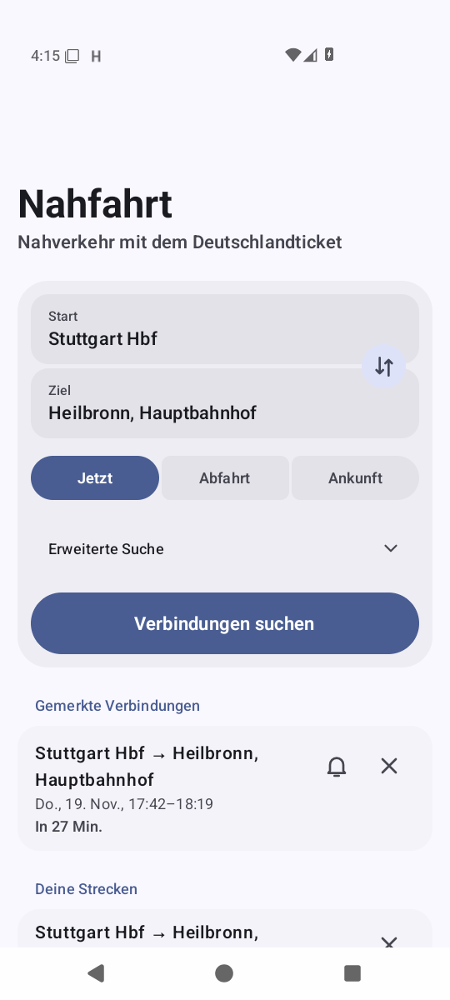
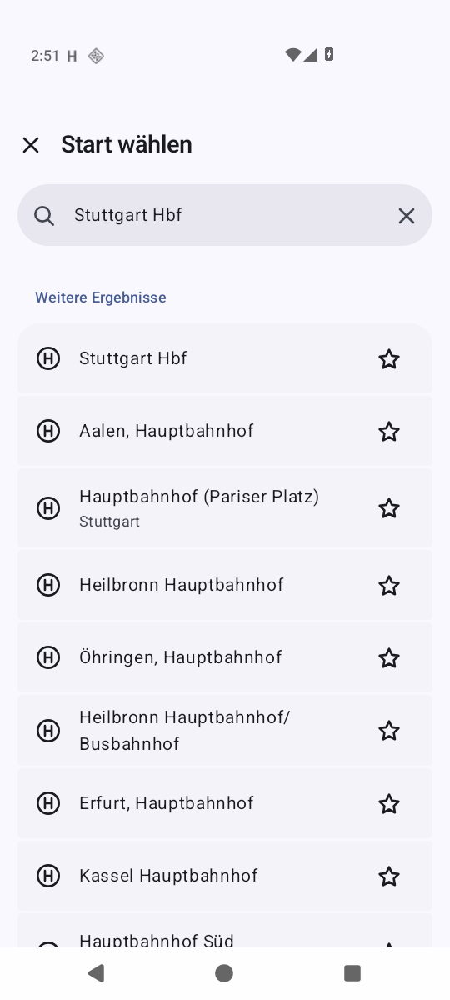
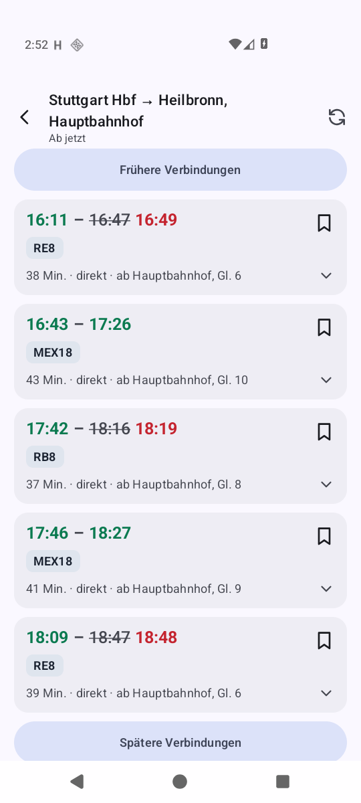
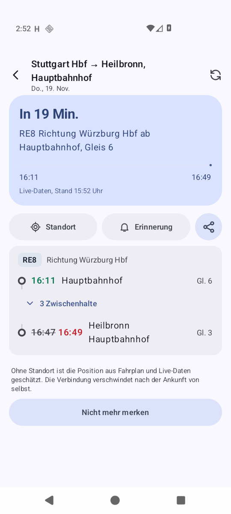

# Nahfahrt

Schlanke Verbindungsauskunft für Android, nur für Verbindungen mit dem Deutschlandticket. Gedacht für schlechtes Netz und knappes Datenvolumen. Kein Angebot der Deutschen Bahn.

<p>
  
  
  
  
</p>

## Installieren

Die aktuelle APK liegt unter [Releases](https://github.com/ElianDarou/nahfahrt/releases/latest). Android 8 oder neuer ist nötig. Android fragt beim ersten Mal, ob Installationen aus dieser Quelle erlaubt sind.

## Was die App kann

- **Nur Nahverkehr:** Bus, Tram, U-Bahn, S-Bahn, Regionalzug und Fähre, ohne Fernverkehr und Fernbusse.
- **Stationen sofort finden:** Genutzte Stationen liegen auf dem Gerät und stehen beim Tippen ganz oben, sortiert nach Häufigkeit und letzter Nutzung. Weitere Treffer laden darunter nach.
- **Favoriten und Strecken:** Favoriten lassen sich benennen, häufige Strecken starten mit einem Tipp.
- **Live-Daten:** Verspätungen, Ausfälle und Gleise, soweit die Verkehrsbetriebe sie liefern. Knappe Umstiege werden markiert.
- **Offline nutzbar:** Die zuletzt geladenen Verbindungen einer Strecke bleiben ohne Netz sichtbar.
- **Datum und Uhrzeit:** Suche nach Abfahrt oder Ankunft, dazu frühere und spätere Verbindungen.
- **Erweiterte Suche (aufklappbar):** Reihenfolge nach Abfahrt, Dauer oder Umstiegen, Zeitfenster für Abfahrt und Ankunft, maximale Umstiege und Reisedauer, Verkehrsmittel, Fußweg, längere Umstiegszeit, Zwischenhalt mit Aufenthalt und stufenfreie Fußwege.
- **Verbindungen merken und live verfolgen:** Gemerkte Verbindungen stehen auf der Startseite. Die Live-Ansicht zeigt Fortschritt, passierte Halte, den nächsten Halt, Umstiege, Verspätungen und Gleiswechsel. Nach der Ankunft verschwindet die Verbindung von selbst.
- **Mein Standort:** Der genaue Standort kann der Start oder das Ziel einer Suche sein, dazu gibt es Haltestellen in der Nähe. In der Live-Ansicht zeigt die App auf Wunsch, wo du wirklich bist und wo du laut Fahrplan sein solltest.
- **Stationen lang drücken:** In der Suche, den Ergebnissen und der Live-Ansicht öffnet langes Drücken „Als Start nehmen“, „Als Ziel nehmen“ und „Zu Favoriten hinzufügen“. In Ergebnissen und Live-Ansicht reicht auch ein Tipp.
- **Erinnerungen (optional):** Die Glocke an einer gemerkten Verbindung erinnert 10 Minuten vor dem Losgehen und 2 Minuten vor jedem Ausstieg.
- **Teilen:** Eine Verbindung lässt sich als Bild im Look der App, als bearbeitbarer Text oder als beides teilen.

## Datenmenge

Die Oberfläche steckt komplett in der App, übers Netz läuft nur die Suche. Das Backend kürzt die Antworten auf das Nötigste. Im Voraus lädt die App nur, was der Nutzer gleich braucht: Eine Suche startet, sobald der Finger den Knopf berührt, im WLAN auch schon beim App-Start für die Strecke in der Maske. Die Halte einer aufgeklappten Verbindung lädt sie für dieses eine Fahrzeug, auf WLAN auch für das nächste.

| | Rohdaten (gzip) | Nahfahrt (gzip) |
|---|---|---|
| Größte Testsuche (5 Verbindungen, viele Umstiege) | 101 KB | etwa 0,7 KB |
| Typische Suche auf Testrouten | etwa 39 KB | 0,3–1 KB |
| Live-Ansicht: alle Halte einer Fahrt laden | | etwa 0,2 KB je Fahrt |
| Live-Ansicht: Aktualisierung pro Minute | | etwa 0,05 KB je Fahrt |
| Haltestellen in der Nähe | | etwa 0,3 KB |
| APK | | etwa 1,9 MB |

## Aufbau

```
Android-App (Kotlin, Compose)  →  Convex HTTP Actions  →  Transitous (MOTIS)
Material 3 Expressive              kürzt, filtert, zählt     Fahrplan und Echtzeit
lokaler Speicher im Gerät
```

Die App ist nativ in Kotlin mit Jetpack Compose und Material 3 Expressive geschrieben. Sie folgt auf Android 12 und neuer den Farben des Hintergrundbilds; Linienfarben und Verspätungsfarben bleiben fest.

- `android/app/src/main/java/…/model/`: die kurzen Datenformate des Backends
- `…/logic/`: reine Logik ohne Android: Ranking, Filter, Fortschritt, Standortabgleich, Erinnerungsplan, Teilen-Text
- `…/data/`: Netz (`Api.kt`, `RequestCache.kt`), Speicher auf dem Gerät (`Store.kt`, `Saved.kt`), Haltestellen auflösen
- `…/platform/`: Standort, Erinnerungen über `AlarmManager`, Teilen-Bild, Übernahme der Daten aus der Web-Version
- `…/ui/`: Compose-Oberfläche
- `convex/lib/`: Abfragen an Transitous, Filter und Kürzung als reine, getestete Funktionen
- `convex/http.ts`: Endpunkte `/v1/places`, `/v1/nearby`, `/v1/journeys` und `/v1/trip`
- `convex/quota.ts`: Tageslimits für Abfragen an Transitous

### Warum nicht direkt die Bahn-API?

Die DB bietet keine offene API für Verbindungssuchen an. Die Schnittstellen hinter ihren Apps sind inoffiziell und für Server gesperrt. Deshalb nutzt Nahfahrt [Transitous](https://transitous.org), einen freien Dienst mit offenen Fahrplandaten.

Beim Vergleich mit bahn.de (Filter „Nur D-Ticket-Verbindungen“) wurden 39 von 40 Verbindungen auf 8 Suchen gefunden, siehe `scripts/compare-bahn.mjs`. Die Suchparameter wurden an denselben Suchen abgestimmt, auf anderen Strecken kann die Quote niedriger sein.

## Grenzen

- **Der Deutschlandticket-Filter ist eine Näherung.** Er filtert nach Verkehrsmittel. Einzelne IC-Strecken mit Ticketanerkennung können fehlen, und grenzüberschreitende Abschnitte werden nicht ausgeschlossen.
- **Live-Daten sind lückenhaft,** vor allem bei Bussen im ländlichen Raum. Ohne Daten zeigt die App die Planzeit und in der Detailansicht „Keine Live-Daten“.
- **Einzelne Haltestellennamen** kommen ohne Ort aus den Quelldaten, etwa nur „Hauptbahnhof“.
- **Ersatzverkehr** erscheint teils anders als bei der Bahn. Solche Fahrten sind in der Detailansicht gekennzeichnet.
- **Tageslimit:** Das öffentliche Backend erlaubt 700 Verbindungssuchen an Transitous pro Tag, Suchen mit einer Adresse zählen doppelt. Für Live-Abfragen gilt ein eigenes Limit von 20.000.
- **Live-Position:** Ohne Standort wird sie aus Fahrplan und Live-Daten geschätzt. Mit Standort vergleicht die App mit geraden Linien zwischen den Halten, weil die echte Strecke nicht bekannt ist. Beides läuft nur bei geöffneter App.
- **Erinnerungen kennen nur den letzten Stand:** Die Zeiten rücken mit Verspätungen mit, aber nur solange die App offen ist oder wieder geöffnet wird. Bei geschlossener App fragt sie nichts ab. Nach einem Neustart des Handys stellt sie die Erinnerungen selbst wieder her.
- **Kein Fahrrad-Filter:** Die Quelldaten kennzeichnen auch Regionalzüge und S-Bahnen als „keine Fahrradmitnahme“. Der Filter fände deshalb praktisch nichts.
- **Stufenfreie Fußwege** betreffen nur die Wege zu Fuß, nicht den Einstieg ins Fahrzeug.

## Datenschutz

Stationen, Favoriten und Verlauf bleiben auf dem Gerät. Beim ersten Start nach dem Wechsel von Version 0.4 übernimmt die App sie einmalig aus dem Speicher der alten Web-Oberfläche; dabei verlässt nichts das Handy. Antworten auf Haltestellensuchen ohne Ziffern bleiben dort bis zu 30 Tage, damit eine wiederholte Suche keine Daten braucht; Adresssuchen nur bis die App geschlossen wird. Für eine Suche gehen Suchtext oder Koordinaten über das Convex-Backend an Transitous. Das Backend speichert den Tageszähler und, bei reinen Haltestellensuchen, den Suchtext mit einer auf etwa einen Kilometer gerundeten Region für 30 Tage, damit dieselbe Suche nicht erneut zu Transitous geht. Antworten mit Adressen werden nicht gespeichert. Ein Konto gibt es nicht.

Der Standort ist optional und wird nur bei geöffneter App abgefragt:

- **Gespeichert wird er nicht:** weder in der App noch im Backend. Suchen mit Standort sind zusätzlich vom HTTP-Cache ausgenommen.
- **In der Live-Ansicht** bleibt er auf dem Gerät, der Vergleich läuft lokal.
- **Bei „Mein Standort“ und „Haltestellen in der Nähe“** gehen die genauen Koordinaten für diese eine Anfrage über das Backend an Transitous, sonst ließe sich nichts berechnen. Wie Transitous seine Zugriffe protokolliert, liegt außerhalb dieses Projekts.

## Entwicklung

Nötig sind JDK 17 oder neuer und das Android-SDK (API 36), für das Backend Node 22.

```bash
cd android && ./gradlew :app:testDebugUnitTest   # Unit-Tests der App
cd android && ./gradlew :app:installDebug        # auf ein Gerät spielen
./scripts/build-android.sh                       # signierte Release-APK
npm install && npm test                          # Backend-Tests
npx convex dev                                   # eigenes Backend anlegen, schreibt .env.local
API_URL=https://<deployment>.convex.site npm run compare   # Vergleich mit bahn.de
```

`.env.production` enthält mit `CONVEX_SITE_URL` die Adresse des öffentlichen Backends; der Android-Build liest sie von dort (oder aus der Umgebungsvariable `NAHFAHRT_API_URL`). Für einen eigenen Betrieb bitte eine eigene Convex-Instanz eintragen.
